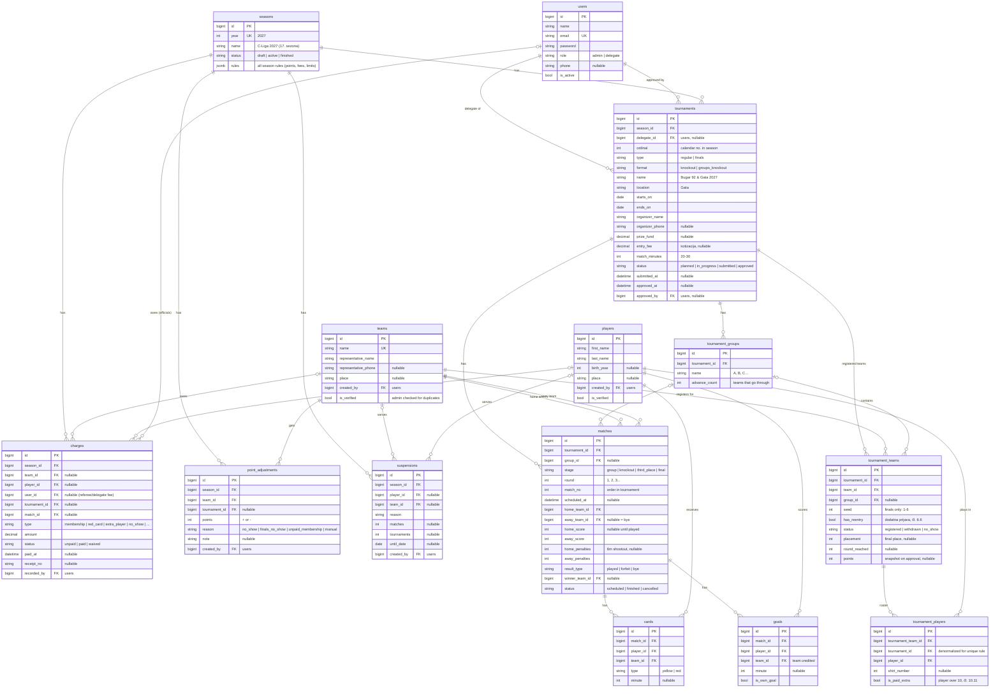

# C-Liga — Database design (ERD)

Status: **draft v1** — under review before migrations are written.

Source of rules: *Propozicije C-Lige 2026* (articles referenced as e.g. `čl. 2.6`).

## Diagram

> Not shown: Laravel system tables (`cache`, `jobs`, `sessions`, `password_reset_tokens`)
> and `activity_log` (audit log from `spatie/laravel-activitylog`, records every change and who made it).

## Tables

### `users`
Admins and delegates. One `role` column is enough for two roles; access is enforced with policies
and `canAccessPanel()` (admin → `/admin`, delegate → `/delegat`).

### `seasons`
One row per year. All rules that may change between seasons live in `rules` (jsonb), cast to a
`SeasonRules` PHP object with defaults taken from the 2026 rulebook:

| Key | 2026 value | Rule |
|---|---|---|
| `participation_points` | 1 | čl. 17.6 |
| `first_advance_points` | 2 (then doubles) | čl. 2.6 |
| `third_place_bonus_ratio` | 0.5 | čl. 3.6 |
| `full_attendance_bonus` | 20 | čl. 9.6 |
| `finals_min_attendance_pct` | 33 | čl. 7.6 |
| `finals_team_count` | 6 | čl. 2.7 |
| `max_players_per_tournament` | 13 | čl. 10.11 |
| `free_players_limit` | 10 | čl. 10.11 |
| `extra_player_fee` | 50 KM | čl. 10.11 |
| `team_membership_fee` | 10 KM | čl. 2.3 |
| `red_card_fine` | 30 KM | čl. 5.3 |
| `no_show_fine` / `no_show_points` | 50 KM / −1 | čl. 20.6 |
| `name_change_fee` | 30 KM | čl. 2.4 |
| `finals_max_players` / `finals_new_players` / `finals_new_player_fee` | 12 / 3 / 100 KM | čl. 2.9–3.9 |
| `finals_no_show_fine` / `finals_no_show_points` | 500 KM / −20 next season | čl. 7.9 |
| `yellow_cards_for_suspension` | 3 (per tournament) | čl. 11.16 |

Why jsonb and not columns: a new rule in 2027 should not need a migration.

### `tournaments`
One row per calendar entry. The **Finale** is also a tournament (`type = finals`), so it reuses
matches, goals and cards; it just never awards league points.
`status` drives the workflow: delegate enters data (`in_progress`) → submits (`submitted`) →
admin approves (`approved`). Only approved tournaments count in the league table.

### `teams` and `players`
Shared across all tournaments and seasons, so the same player is recognized everywhere
(top scorers, finals eligibility, suspensions). Delegates may create new ones on the spot;
`is_verified` lets the admin review and merge duplicates.

### `tournament_teams` (prijava ekipe)
A team's registration for one tournament. When the admin approves the tournament, the
calculated `placement`, `round_reached` and `points` are **stored as a snapshot**: the league
table stays stable even if rules or code change later.

### `tournament_players` (spisak igrača)
Roster of a team at a tournament. `UNIQUE (tournament_id, player_id)` enforces
*"a player can play for only one team per tournament"* (čl. 11.6) at database level.

### `matches`
`home_team_id`/`away_team_id` point directly to `teams`.
- `result_type = forfeit` → awarded 3:0; counts for goal difference but never for scorers (čl. 5.13).
- `result_type = bye` → team is free in that round (`away_team_id` is null; čl. 8.6: max once per tournament).
- Draws go straight to 6m penalties (čl. 4.13) → `home_penalties`/`away_penalties`.
- `CHECK (home_team_id <> away_team_id)`.

### `goals` and `cards`
One row per goal / card. Needed for top scorers and tie-breaks (čl. 11.13),
yellow-card suspensions (čl. 11.16) and red-card fines (čl. 10.16).

### `charges` (zaduženja)
Every fee or fine from the rulebook. Created automatically where possible
(red card → 30 KM, 11th player → 50 KM, new season → 10 KM membership).
`CHECK` that at least one of `team_id`, `player_id`, `user_id` is set.
Business rule: a team or player with an `unpaid` charge cannot be registered for the next tournament.

### `point_adjustments`
Manual or rule-based point changes outside normal tournament scoring: −1 for a no-show,
−20 for skipping the finals (applied to the *next* season), removal for unpaid membership.
The +20 full-attendance bonus is **calculated**, not stored.

### `suspensions`
Suspensions decided by the Radna grupa (čl. 8.16). Automatic ones (3 yellow cards in a
tournament) are calculated from `cards` and are not stored.

## Derived data (calculated, not stored)
- **League table** = Σ `tournament_teams.points` (approved, regular) + Σ `point_adjustments`
  + full-attendance bonus; tie-breaks per čl. 5.6.
- **Top scorers** = `goals` from approved regular tournaments, excluding forfeits and own goals; tie-breaks per čl. 11.13.
- **Group standings** = from group `matches` (3 / 1 / 0 points, tie-breaks per čl. 3.13).
- **Finals eligibility** = participation ≥ `finals_min_attendance_pct` of the season's tournaments.

## Open questions (to confirm with C-Liga)
1. **Re-entry (čl. 6.6):** if a team re-enters after losing in round 1, which result counts for points?
2. **Group stage scoring (čl. 13.6, 9.13):** exact points for group winners and runners-up (references the 2025 rulebook).
3. **Bye:** does a bye count as advancing a round (and award points)?
4. **Referees and officials:** track them (and their 10 KM/day fees) now, or later?
5. **Team name changes (čl. 1.4–4.4):** keep a name history table, or rely on the audit log?
